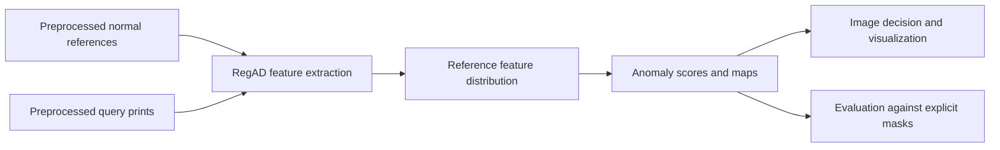

# Few-Shot Anomaly Detection for Foil-Stamped Prints

**Adapting RegAD to industrial visual inspection with limited normal examples.**

Nippon AI Dojo team project · Final presentation: January 29, 2026

[Presentation](docs/final-presentation.pdf) · [Project and contributions](docs/project-notes.md) · [Results and evaluation](docs/evaluation.md) · [Original RegAD paper](https://arxiv.org/abs/2207.07361)

## The problem

Foil-stamping defects are difficult to identify consistently when normal reference images are scarce and photographs vary in lighting, reflection, background, and alignment. This project explored a few-shot inspection workflow that compares a query print with normal examples and produces an anomaly map for inspection.

## Project contribution

This repository contains the RegAD portion of the team project: adapting inference to custom industrial images, loading normal support sets, generating anomaly visualizations, and evaluating predictions against defect masks. The broader project investigated background removal, geometric alignment, augmentation, alternative detectors, and positional drift detection. See [scope and attribution](docs/project-notes.md) for the distinction between the code included here and the wider team workflow.



## Reported results

| Configuration | Classification accuracy | Mean pixel-level AUROC |
| --- | ---: | ---: |
| RegAD on raw images | 93% | 69.15% |
| RegAD after preprocessing | **100%** | **87.42%** |
| Enhanced PatchCore, team comparison | **100%** | 83.02% |

These are results reported in the final presentation on a small project dataset containing real and synthetic anomalies. RegAD had the higher reported localization AUROC and tied enhanced PatchCore on classification accuracy. They have not been reproduced from this cleaned code release. Dataset splits, aggregation details, timing limitations, and the current evaluation interface are documented in [evaluation notes](docs/evaluation.md).

## Getting started

### 1. Environment

Use Python 3.10 as a starting point. Install a compatible PyTorch/torchvision pair for your hardware, following [PyTorch installation guidance](https://pytorch.org/get-started/locally/), then install the remaining dependencies:

```bash
git clone https://github.com/Tarunno360/Foil-Stamp-Anomaly-Detection.git
cd Foil-Stamp-Anomaly-Detection
python -m venv .venv
source .venv/bin/activate
python -m pip install -r requirements.txt
```

Dependency ranges are guidance rather than a tested environment lock. The model and private-data experiments have not been rerun during this documentation cleanup.

### 2. Checkpoint and data

Obtain a compatible RegAD checkpoint from the [upstream project](https://github.com/MediaBrain-SJTU/RegAD) or your own training. The checkpoint must contain `STN`, `ENC`, and `PRED` state dictionaries and match the selected STN mode. Load only checkpoints from a trusted source. Client data and pretrained weights are not included.

Prepare already aligned, background-processed images for one print category:

```text
data/example/
├── support/          # Normal reference images only
├── test/             # Independent normal and anomalous images
└── masks/            # One binary PNG mask per test image
save_checkpoints/
└── model.pt
```

For `test/sample.jpg`, use `masks/sample.png` or `masks/sample_mask.png`. Masks use zero for normal pixels and nonzero for defects. Normal images need explicit all-zero masks. Keep support images and their augmented derivatives separate from test images. The scripts load all images in the support folder; `--shot` selects checkpoint conventions and does not cap the folder size.

### 3. Inference and visualizations

Calibrate a **raw-score threshold** on separate validation data. Set `CALIBRATED_THRESHOLD` to that measured value before running:

```bash
python inference.py \
  --support_dir data/example/support \
  --test_dir data/example/test \
  --checkpoint_path save_checkpoints/model.pt \
  --stn_mode rotation_scale \
  --threshold "${CALIBRATED_THRESHOLD:?Set a validation-calibrated raw-score threshold}" \
  --output_dir outputs/example
```

Outputs include heatmaps, overlays, visualization masks, and `predictions.txt`. Classification uses raw maximum anomaly scores, so a prediction does not depend on the other images in its test batch. Heatmap normalization and the display-mask cutoff serve visualization only. Old normalized thresholds from development notes do not apply.

### 4. Evaluate localization and image ranking

```bash
python model_evaluation_AUROC.py \
  --support_dir data/example/support \
  --test_dir data/example/test \
  --mask_dir data/example/masks \
  --checkpoint_path save_checkpoints/model.pt \
  --stn_mode rotation_scale \
  --output_dir outputs/evaluation
```

This computes pooled pixel-level AUROC and image-level AUROC, not classification accuracy. Missing masks stop evaluation; undefined AUROC is reported as `nan`. Run categories separately and state how results are aggregated.

## Repository guide

| Path | Purpose |
| --- | --- |
| `inference.py` | Custom-image prediction and visualization |
| `model_evaluation_AUROC.py` | Mask-based pixel and image AUROC |
| `models/`, `losses/`, `utils/` | RegAD model and shared utilities |
| `datasets/`, `train.py`, `test.py` | Inherited MVTec benchmark workflow |
| `docs/` | Presentation, project scope, evaluation notes |
| `requirements.txt` | Dependency guidance |

The benchmark scripts require the MVTec data, matching support-set files, and checkpoints described by the upstream project. They are separate from the custom-image commands above.

## Limitations and next steps

Small defects, reflections, residual background, and positional changes remain challenging. Further work should use more independent real defects, fixed validation thresholds, documented support/test splits, and consistent end-to-end timing. The presentation contains failure examples as well as successful detections.

## Attribution

Based on **Registration based Few-Shot Anomaly Detection**, Huang et al., ECCV 2022. [Paper](https://arxiv.org/abs/2207.07361) · [Upstream code](https://github.com/MediaBrain-SJTU/RegAD).

The original MIT license is retained. [Project notes](docs/project-notes.md) credit the team and explain the scope of this adaptation. Use repository issues for questions about this version.
